# Cuaderno de reconocimiento pasivo

En este cuaderno anoto qué consulté, qué me devolvió la fuente y para qué me sirve cada dato. "Pasivo" describe aquí el tipo de reconocimiento: no hice escaneos de puertos ni pruebas contra servicios, aunque algunas consultas (por ejemplo, DNS o descargar un archivo público con `curl`) sí generan peticiones a una fuente. La lista de `scope.txt` es una allowlist estricta; los nombres descubiertos que no aparecen allí no se consideran autorizados para probar.

## Registro 1 — Preparación del alcance

- **Fecha:** 28/10/2026
- **Hora:** 12:39
- **Objetivo:** Inventario inicial de activos de Anthropic.
- **Técnica:** Revisión de la política y del CSV público de HackerOne.
- **Fuente:** https://hackerone.com/anthropic
- **Acción:** Revisé las directrices del programa y seleccioné hosts para el reconocimiento pasivo.
- **Resultado:** Se creó `scope.txt` con siete hosts para la revisión inicial.
- **Limitaciones:** La inclusión en este listado no autoriza pruebas activas. Se respetarán las instrucciones específicas de cada activo.
- **Siguiente paso:** Consultar información WHOIS pública y registrar los resultados.

### Explicado fácil

Antes de buscar información técnica, revisé qué sistemas incluye el programa y apunté los nombres que aparecen expresamente en la información de alcance. Esto me sirve para no confundir un dominio que encuentro por internet con uno que tengo permiso para analizar. Me llevo una lista concreta de siete hosts para el inventario; no puse un comodín, así que un subdominio nuevo no entra automáticamente.

## Registro 2 — WHOIS de claude.ai

- **Fecha:** 28/10/2026
- **Hora:** 12:50, hora local aproximada
- **Objetivo:** claude.ai
- **Estado de alcance:** incluido en `scope.txt`.
- **Técnica:** Consulta registral pasiva mediante ICANN Lookup.
- **Fuente:** https://lookup.icann.org/
- **Acción:** Consulté los datos públicos del registro del dominio.
- **Resultado observado:**
  - Registrador: Markmonitor Inc.
  - Creación: 2018-08-04.
  - Expiración: 2029-08-04.
  - Última actualización indicada: 2026-08-12.
  - Nameservers: isla.ns.cloudflare.com y randy.ns.cloudflare.com.
  - Estados: clientDeleteProhibited, clientTransferProhibited y clientUpdateProhibited.
  - DNSSEC: la delegación aparece como Unsigned.
  - Los datos de contacto del titular aparecen redactados por privacidad.
- **Interpretación:** El dominio utiliza nameservers de Cloudflare. Los datos del titular no están disponibles en el resultado consultado. No se ha identificado ninguna vulnerabilidad mediante esta consulta.
- **Limitación:** El comando whois desde Kali devolvió Network is unreachable; se utilizó ICANN Lookup como alternativa web.
- **Siguiente paso:** Consultar los registros DNS públicos.

### Explicado fácil

WHOIS sirve para consultar la ficha pública de un dominio: quién lo registró, cuándo se creó y qué servidores de nombres usa. En mi caso, la consulta desde la terminal no funcionó, así que usé ICANN Lookup. Me llevo el nombre del registrador, las fechas, los nameservers de Cloudflare y que los datos del titular están protegidos. Esto ayuda a entender quién gestiona el registro y a dónde se delega el DNS, pero no demuestra que haya un problema de seguridad.

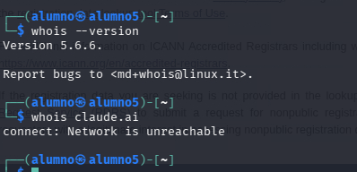
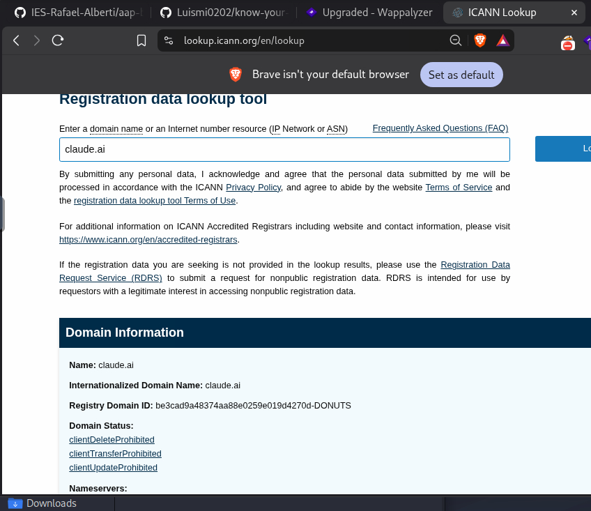

## Registro 3 — DNS A de claude.ai

- **Fecha:** 28/10/2026
- **Hora:** 11:52 UTC
- **Objetivo:** claude.ai
- **Estado de alcance:** incluido en `scope.txt`.
- **Técnica:** Consulta DNS pasiva mediante dig.
- **Comando:** dig claude.ai A
- **Resultado observado:** NOERROR; se obtuvo un registro A con la dirección IPv4 160.79.104.10 y TTL de 300 segundos.
- **Servidor DNS consultado:** 8.8.8.8.
- **Tiempo de consulta:** 21 ms.
- **Interpretación:** La consulta devolvió una dirección IPv4 para el dominio en el momento de la observación.
- **Limitación:** Una única consulta no permite afirmar que sea la única dirección IP asociada al dominio.
- **Siguiente paso:** Consultar el registro MX para comprobar si el dominio publica información de servidores de correo.

### Explicado fácil

El tipo A del DNS relaciona un nombre con una dirección IPv4. Consulté `claude.ai` para saber a qué dirección apuntaba en ese momento, y me llevé `160.79.104.10` para anotarla y usarla después al consultar fuentes públicas como Shodan InternetDB. La respuesta es solo una instantánea: puede cambiar y, por sí sola, no indica qué servicio hay detrás.

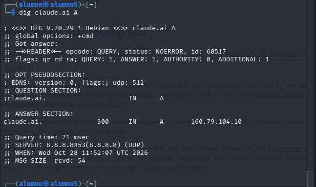

## Registro 4 — DNS MX de claude.ai

- **Fecha:** 28/10/2026
- **Hora:** 11:57 UTC
- **Objetivo:** claude.ai
- **Estado de alcance:** incluido en `scope.txt`.
- **Técnica:** Consulta DNS pasiva mediante dig.
- **Comando:** dig claude.ai MX
- **Resultado observado:** Estado NOERROR, ANSWER: 0. No se devolvieron registros MX. La sección AUTHORITY contiene un registro SOA que identifica isla.ns.cloudflare.com como servidor primario indicado.
- **Servidor DNS consultado:** 8.8.8.8.
- **Tiempo de consulta:** 23 ms.
- **Interpretación:** La consulta no devolvió registros MX para claude.ai en el momento de la observación.
- **Limitación:** Este resultado no permite concluir que Anthropic carezca de servicios de correo.
- **Siguiente paso:** Consultar el registro TXT público del dominio.

### Explicado fácil

El registro MX indica qué servidores reciben el correo dirigido a un dominio. Pregunté por el MX de `claude.ai` y la respuesta no trajo ninguno. Me llevo ese resultado para describir lo que publica este dominio concreto; no puedo concluir que la organización no tenga correo, porque podría gestionarlo desde otro dominio.

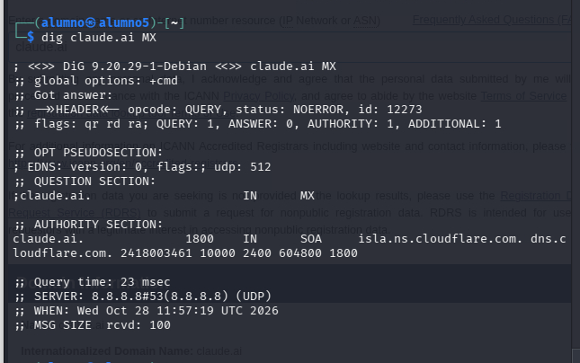

## Registro 5 — DNS TXT de claude.ai

- **Fecha:** 28/10/2026
- **Hora:** 11:59 UTC
- **Objetivo:** claude.ai
- **Estado de alcance:** incluido en `scope.txt`.
- **Técnica:** Consulta DNS pasiva mediante dig.
- **Comando:** dig claude.ai TXT
- **Resultado observado:** NOERROR; se devolvieron 6 registros TXT, todos con TTL de 300 segundos.
- **Contenido observado:** Cuatro registros google-site-verification, un registro SPF con valor "v=spf1 -all" y una cadena TXT adicional cuyo propósito no se ha determinado.
- **Servidor DNS consultado:** 8.8.8.8.
- **Tiempo de consulta:** 14 ms.
- **Interpretación:** El dominio publica valores de verificación y una política SPF que indica que ningún servidor está autorizado a enviar correo usando esa identidad SPF.
- **Limitación:** No se ha verificado el propósito de la cadena adicional ni se han probado los mecanismos de verificación.
- **Siguiente paso:** Consultar los registros CAA públicos del dominio.

### Explicado fácil

Los registros TXT permiten publicar texto asociado al dominio, por ejemplo verificaciones de servicios o políticas de correo. La consulta devolvió seis registros: cuatro de verificación de Google, uno con `v=spf1 -all` y otro cuyo propósito no identifiqué. Me llevo esos datos como pistas de servicios vinculados y de la política SPF publicada, sin intentar validar las verificaciones ni asumir para qué sirve el texto que no reconocí.

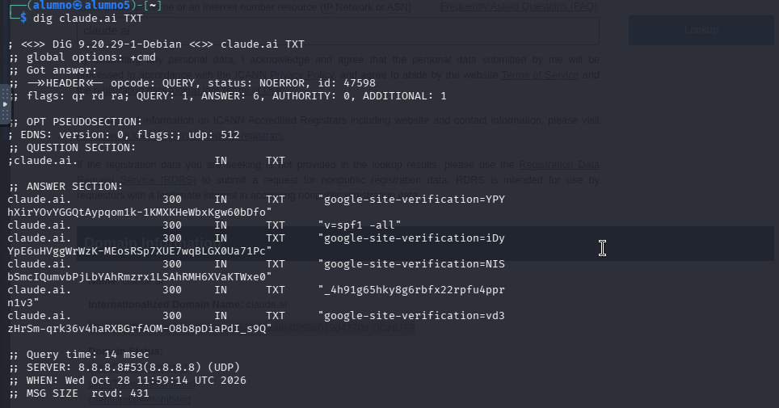

## Registro 6 — DNS CAA de claude.ai

- **Fecha:** 28/10/2026
- **Hora:** 12:02 UTC
- **Objetivo:** claude.ai
- **Estado de alcance:** incluido en `scope.txt`.
- **Técnica:** Consulta DNS pasiva mediante dig.
- **Comando:** dig claude.ai CAA
- **Resultado observado:** NOERROR; se devolvieron 18 registros CAA, con TTL de 300 segundos.
- **Contenido observado:** Registros issue e issuewild que mencionan distintas autoridades certificadoras, entre ellas Let's Encrypt, DigiCert, Amazon, SSL.com, Google PKI y otras.
- **Servidor DNS consultado:** 8.8.8.8.
- **Tiempo de consulta:** 16 ms.
- **Interpretación:** El dominio publica una política CAA que enumera autoridades certificadoras para la emisión de certificados normales y wildcard.
- **Limitación:** La consulta no verifica certificados emitidos ni demuestra vulnerabilidades.
- **Siguiente paso:** Consultar los registros AAAA públicos del dominio.

### Explicado fácil

CAA es un tipo de registro DNS que publica qué autoridades certificadoras pueden emitir certificados para el dominio. La respuesta mostró 18 registros. Me llevo la lista como referencia de la política publicada, pero no comprobé certificados ni intenté emitir uno; ver estos registros no es encontrar una vulnerabilidad.

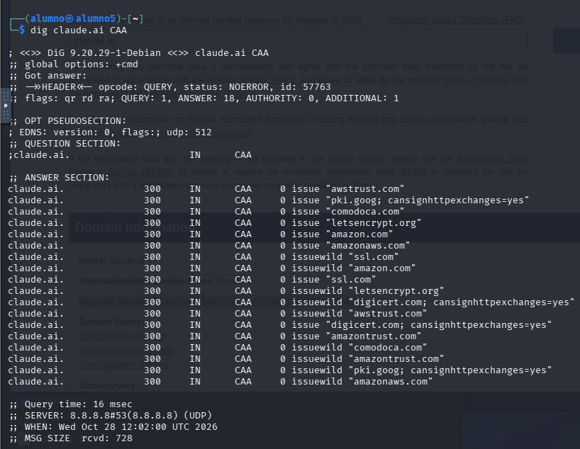

## Registro 7 — DNS AAAA de claude.ai

- **Fecha:** 28/10/2026
- **Hora:** 12:04 UTC
- **Objetivo:** claude.ai
- **Estado de alcance:** incluido en `scope.txt`.
- **Técnica:** Consulta DNS pasiva mediante dig.
- **Comando:** dig claude.ai AAAA
- **Resultado observado:** NOERROR; se devolvió una dirección IPv6: 2607:6bc0::10, con TTL de 300 segundos.
- **Servidor DNS consultado:** 8.8.8.8.
- **Tiempo de consulta:** 25 ms.
- **Interpretación:** El dominio publicó una dirección IPv6 en el momento de la consulta. También se había observado una dirección IPv4 en la consulta A.
- **Limitación:** Los resultados corresponden a una observación puntual y pueden cambiar.
- **Siguiente paso:** Revisar los registros NS del dominio.

### Explicado fácil

El tipo AAAA cumple una función parecida al A, pero devuelve una dirección IPv6. Para `claude.ai` apareció `2607:6bc0::10`. Me llevo esta dirección junto a la IPv4 que ya había anotado, para que el inventario no se quede solo con IPv4. También es un dato puntual que puede cambiar.

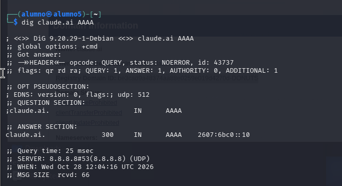

## Registro 8 — DNS NS de claude.ai

- **Fecha:** 28/10/2026
- **Hora:** 12:06 UTC
- **Objetivo:** claude.ai
- **Estado de alcance:** incluido en `scope.txt`.
- **Técnica:** Consulta DNS pasiva mediante dig.
- **Comando:** dig claude.ai NS
- **Resultado observado:** NOERROR; se devolvieron dos registros NS: isla.ns.cloudflare.com y randy.ns.cloudflare.com.
- **TTL:** 21600 segundos para ambos registros.
- **Servidor DNS consultado:** 8.8.8.8.
- **Tiempo de consulta:** 19 ms.
- **Interpretación:** Los servidores de nombres observados coinciden con los indicados en la consulta ICANN Lookup.
- **Limitación:** La consulta identifica servidores DNS, pero no demuestra la existencia ni ausencia de vulnerabilidades.
- **Siguiente paso:** Consultar el registro SOA del dominio.

### Explicado fácil

Los registros NS dicen qué servidores responden por el DNS del dominio. La consulta devolvió `isla.ns.cloudflare.com` y `randy.ns.cloudflare.com`, los mismos que vi en ICANN Lookup. Me llevo la confirmación de que ambas fuentes coinciden y una pista de que Cloudflare gestiona el DNS; esto describe la configuración publicada, no la seguridad de esos servidores.

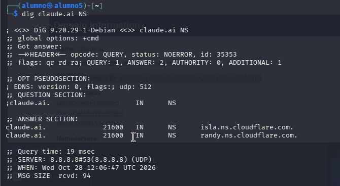

## Registro 9 — Descubrimiento pasivo de subdominios

- **Fecha:** 28/10/2026
- **Objetivo:** anthropic.com
- **Estado de alcance:** `anthropic.com` no está en la allowlist `scope.txt`; se consultó crt.sh como fuente pública de certificados, no como autorización para probar el dominio ni sus subdominios.
- **Técnica:** Consulta de certificados TLS públicos mediante crt.sh.
- **Fuente:** https://crt.sh/?q=%25.anthropic.com
- **Comando utilizado:** curl -s 'https://crt.sh/?q=%25.anthropic.com&output=json' | python3 -c 'import sys,json; d=json.load(sys.stdin); print("\n".join(sorted({x["name_value"] for x in d if x.get("name_value")})))'
- **Resultado observado:** Se obtuvieron numerosos nombres de dominio y subdominio, con duplicados eliminados por el comando y algunos nombres wildcard.
- **Ejemplos encontrados:** api.anthropic.com, api-staging.anthropic.com, console.anthropic.com, docs.anthropic.com, support.anthropic.com, status.anthropic.com y www.anthropic.com.
- **Interpretación:** Los certificados públicos permiten identificar nombres asociados a la infraestructura y servicios de Anthropic.
- **Limitación:** Los resultados no confirman que todos los nombres estén activos ni que pertenezcan al alcance autorizado. Se contrastarán con scope.txt y la política del programa.
- **Siguiente paso:** Revisar la huella tecnológica con Netcraft.

### Explicado fácil

Los certificados TLS que se publican en internet pueden incluir los nombres de los sitios para los que se emitieron. Consulté crt.sh, que permite buscar esos certificados sin escanear cada servidor. Me llevo varios nombres relacionados con Anthropic para compararlos con `scope.txt`. Encontrar un nombre aquí no confirma que siga activo ni que esté autorizado: por eso `status.anthropic.com`, `www.anthropic.com` y cualquier otro nombre que no esté en la allowlist no se añaden automáticamente.

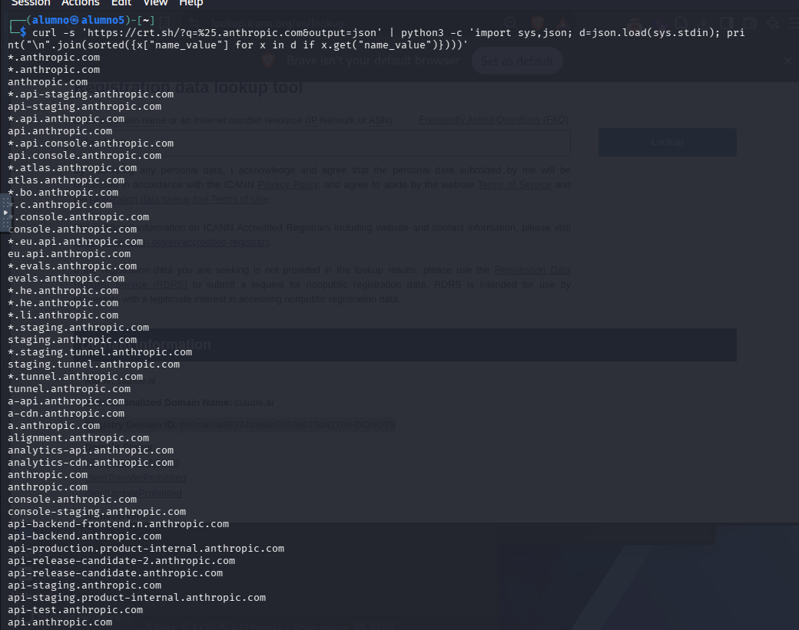

## Registro 10 — Huella tecnológica con Netcraft

- **Fecha:** 28/10/2026
- **Objetivo consultado:** anthropic.com
- **Estado de alcance:** `anthropic.com` no está en `scope.txt`; se consultó el informe público de Netcraft como fuente de información y no se considera un objetivo autorizado para pruebas.
- **Técnica:** Fingerprinting pasivo mediante Netcraft Site Report.
- **Fuente:** https://sitereport.netcraft.com/
- **Resultado observado:** Netcraft identifica Anthropic, PBC como propietario del bloque de red. Indica SignalPoint Communications como empresa de hosting, Cloudflare como CDN/DNS y Google HTTPS Load Balancer como tecnología de aceleración HTTP.
- **Direcciones observadas:** IPv4 160.79.104.10 e IPv6 2607:6bc0::10.
- **DNS:** isla.ns.cloudflare.com; el informe indica DNSSEC habilitado para el dominio consultado.
- **Correo:** el informe muestra SPF con include de _spf.google.com y softfail, además de DMARC con políticas p=reject y sp=reject.
- **Otras tecnologías detectadas:** JavaScript, React Server Components, gzip y varias cabeceras de seguridad del navegador.
- **Interpretación:** La fuente ofrece indicios sobre infraestructura, entrega de contenido y tecnologías web de anthropic.com.
- **Limitación:** Son detecciones de terceros y pueden ser incompletas o variar con el tiempo. El informe consultado indica que la página HTTP no es HTTPS; no se ha comprobado aquí el informe HTTPS ni se han realizado pruebas activas.
- **Siguiente paso:** Revisar robots.txt y security.txt de forma pasiva.

### Explicado fácil

Netcraft reúne información pública sobre cómo parece estar montado un sitio: proveedor de alojamiento, CDN y algunas tecnologías web. Consulté su informe para obtener una primera idea de la infraestructura sin instalar nada ni probar el sitio. Me llevo indicios como Cloudflare, Google HTTPS Load Balancer y tecnologías web reportadas. Como son detecciones de un tercero, pueden estar incompletas o equivocadas; además, la consulta fue sobre `anthropic.com`, que no está en mi allowlist.

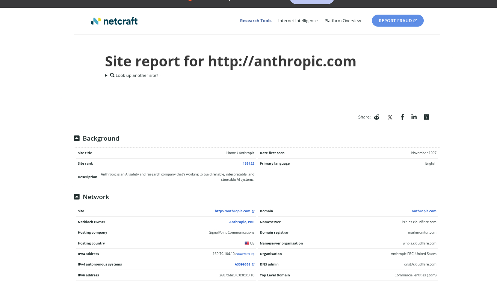

## Registro 11 — Consulta de robots.txt

- **Fecha:** 28/10/2026
- **Objetivo:** anthropic.com
- **Estado de alcance:** `anthropic.com` no está en `scope.txt`; la petición GET a `robots.txt` se hizo para consultar un archivo público, pero no amplía el alcance autorizado.
- **Técnica:** Revisión pasiva de robots.txt.
- **Comando:** curl -sS -L --max-time 15 https://anthropic.com/robots.txt
- **Resultado observado:** User-Agent: *, Allow: / y Sitemap: https://www.anthropic.com/sitemap.xml.
- **Interpretación:** El archivo permite el rastreo general y declara la ubicación del sitemap.
- **Limitación:** robots.txt no es un mecanismo de control de acceso ni confirma que no existan otras rutas.
- **Siguiente paso:** Consultar security.txt en la ubicación estándar.

### Explicado fácil

`robots.txt` es un archivo que un sitio publica para indicar a los rastreadores qué rutas deberían visitar o evitar. Lo consulté para ver si anunciaba rutas o un sitemap. Me llevo la regla `Allow: /` y el enlace al sitemap. No es una lista de permisos ni una barrera de seguridad: que una ruta aparezca ahí no significa que se deba entrar o probar.

## Registro 12 — Consulta de security.txt

- **Fecha:** 28/10/2026
- **Objetivo:** anthropic.com
- **Estado de alcance:** `anthropic.com` no está en `scope.txt`; la petición GET consultó un archivo público de contacto y no autoriza pruebas sobre el dominio.
- **Técnica:** Revisión pasiva del archivo security.txt.
- **Comando:** curl -sS -L --max-time 15 https://anthropic.com/.well-known/security.txt
- **Resultado observado:** El archivo declara un contacto de HackerOne, fecha de expiración 2026-12-31T23:59:00.000Z, idioma preferido inglés, URL canónica, política de divulgación responsable y página de empleo.
- **Interpretación:** Anthropic publica un canal para reportar vulnerabilidades y una política asociada.
- **Limitación:** La presencia de estos enlaces no implica que se haya enviado un informe ni que se haya validado ninguna vulnerabilidad.
- **Siguiente paso:** Consultar información pública de servicios mediante Shodan InternetDB, sin escanear el objetivo.

### Explicado fácil

`security.txt` es un archivo donde una organización puede publicar cómo quiere recibir avisos de seguridad. Lo consulté para identificar el canal de reporte y las condiciones que el propio archivo anuncia. Me llevo el enlace a HackerOne, la política de divulgación, el idioma y la fecha de expiración indicada. No envié ningún informe ni hice pruebas; además, este archivo se consultó en `anthropic.com`, fuera de la allowlist de este ejercicio.

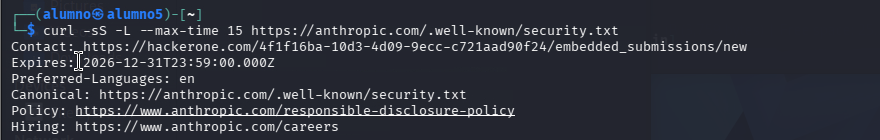

## Registro 13 — Shodan InternetDB

- **Fecha:** 28/10/2026
- **Objetivo:** IP 160.79.104.10, obtenida previamente mediante DNS.
- **Estado de alcance:** la IP se obtuvo al consultar `claude.ai`, que sí figura en `scope.txt`; aquí solo se consultó la base pública de Shodan, sin contactar con los puertos listados.
- **Técnica:** Consulta pasiva de información pública con Shodan InternetDB.
- **Fuente:** https://internetdb.shodan.io/160.79.104.10
- **Comando:** curl -sS --max-time 15 https://internetdb.shodan.io/160.79.104.10
- **Resultado observado:** La respuesta JSON enumera los nombres claude.anthropic.com y a.anthropic.com, el CPE cpe:/a:cloudflare:cloudflare, los puertos 80, 443, 2052, 2082, 2083, 2086, 2087, 2096, 8080, 8443 y 8880, la etiqueta pqc y una lista vacía de vulnerabilidades.
- **Interpretación:** La fuente asocia la IP con Cloudflare y publica metadatos de servicios y nombres relacionados.
- **Limitación:** Los datos de InternetDB pueden estar incompletos o desactualizados. No se realizaron conexiones a los puertos ni pruebas de vulnerabilidad.
- **Siguiente paso:** Realizar búsquedas públicas mediante Google dorks.

### Explicado fácil

InternetDB es una base pública de Shodan que muestra datos que ya conoce sobre una dirección IP. Consulté la IP encontrada en el DNS, en vez de escanearla yo. Me llevo los nombres relacionados, la etiqueta de Cloudflare y los puertos que la base tenía registrados en ese momento. No comprobé si esos puertos responden ahora ni intenté conectarme a ellos; la información puede estar desactualizada.

## Registro 14 — Google dorks: documentos PDF

- **Fecha:** 28/10/2026
- **Objetivo:** anthropic.com
- **Estado de alcance:** la búsqueda usa `anthropic.com` como filtro del buscador; no convierte los resultados ni los hosts enlazados en activos autorizados por `scope.txt`.
- **Técnica:** Búsqueda pasiva mediante Google dorks.
- **Consulta:** site:anthropic.com filetype:pdf
- **Resultado observado:** Se encontraron varios PDF indexados, incluidos informes corporativos, documentos de investigación y publicaciones sobre seguridad de IA. Algunos resultados utilizan el dominio www-cdn.anthropic.com.
- **Interpretación:** Los motores de búsqueda permiten identificar documentos publicados bajo dominios asociados a Anthropic.
- **Limitación:** La indexación pública no demuestra una exposición indebida. No se descargaron ni analizaron documentos potencialmente sensibles.
- **Siguiente paso:** Buscar información de contacto corporativa mediante fuentes públicas.

### Explicado fácil

Un dork es una búsqueda normal en Google con filtros para acotar resultados. Usé `site:anthropic.com filetype:pdf` para localizar PDF que el buscador ya tenía indexados. Me llevo la existencia de documentos públicos y algunos nombres de dominio asociados a los resultados, pero no los descargué para buscar información sensible. Que Google encuentre un archivo no significa que esté expuesto por error ni que el dominio entre en el alcance.

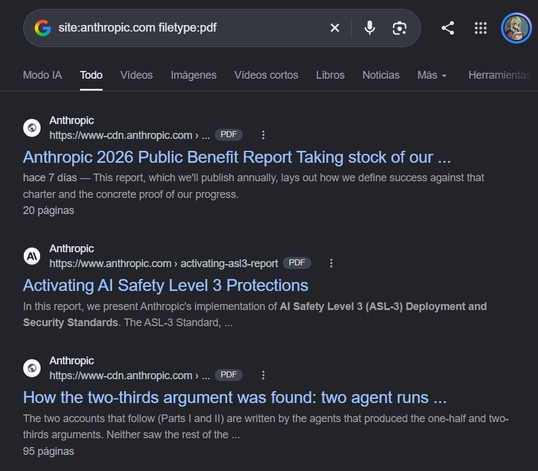

## Registro 15 — Búsqueda pasiva de correos con theHarvester

- **Fecha:** 28/10/2026
- **Objetivo:** anthropic.com
- **Estado de alcance:** `anthropic.com` no está en `scope.txt`; theHarvester consultó la fuente pública crt.sh, sin buscar directamente en los buzones de empleados.
- **Técnica:** Recopilación pasiva de información pública.
- **Herramienta:** theHarvester 4.11.1.
- **Comando:** theHarvester -d anthropic.com -b crtsh
- **Fuente consultada:** CRTsh.
- **Resultado observado:** No se encontraron direcciones IP, correos electrónicos, personas ni hosts en esta consulta.
- **Interpretación:** La fuente consultada no devolvió resultados para esos campos en esta ejecución.
- **Limitación:** La ausencia de resultados no demuestra que no existan correos o hosts públicos.
- **Siguiente paso:** Revisar que los resultados estén reflejados en el mapa de reconocimiento.

### Explicado fácil

theHarvester sirve para reunir datos públicos, como correos y nombres de host, desde distintas fuentes. En esta ejecución le pedí que usara crt.sh, que se basa en certificados y no es una fuente especializada en correos. No devolvió emails ni personas. Me llevo únicamente que esa combinación de herramienta y fuente no encontró resultados; no puedo decir que no existan correos públicos ni deducir un patrón corporativo con esta consulta.

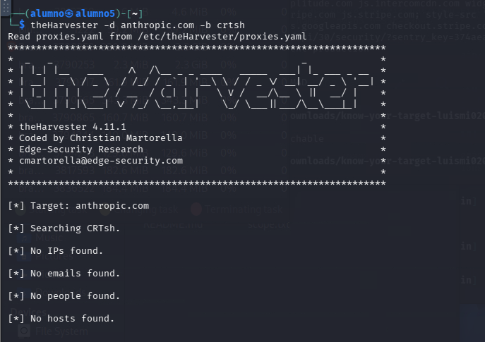
