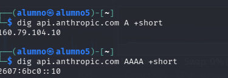
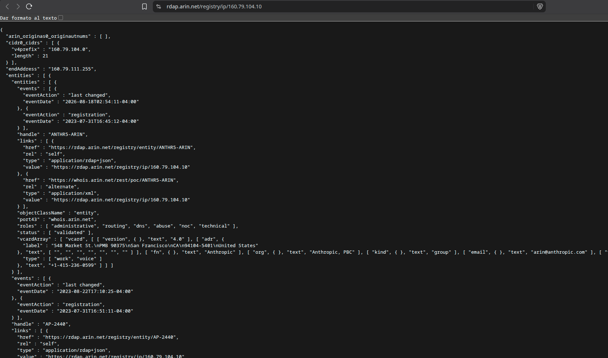
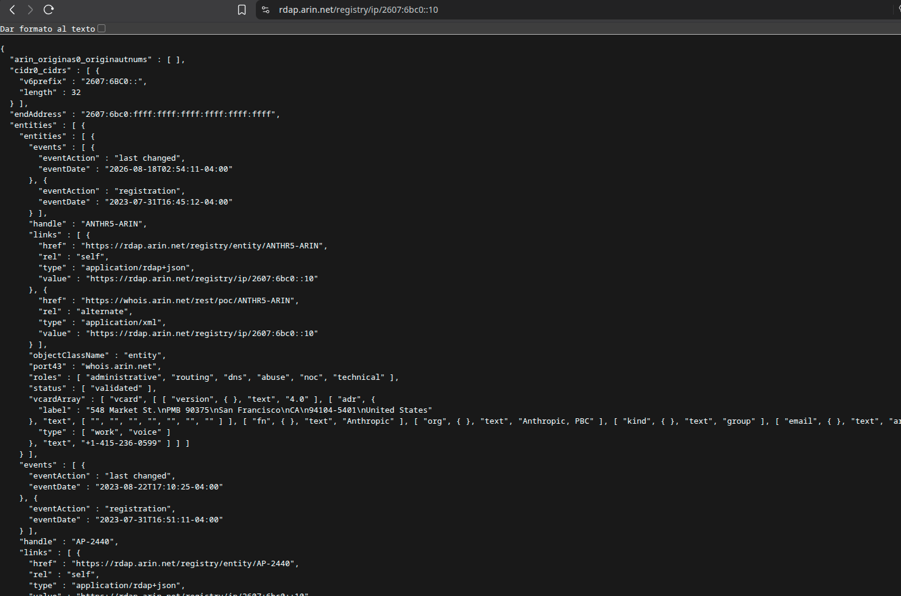
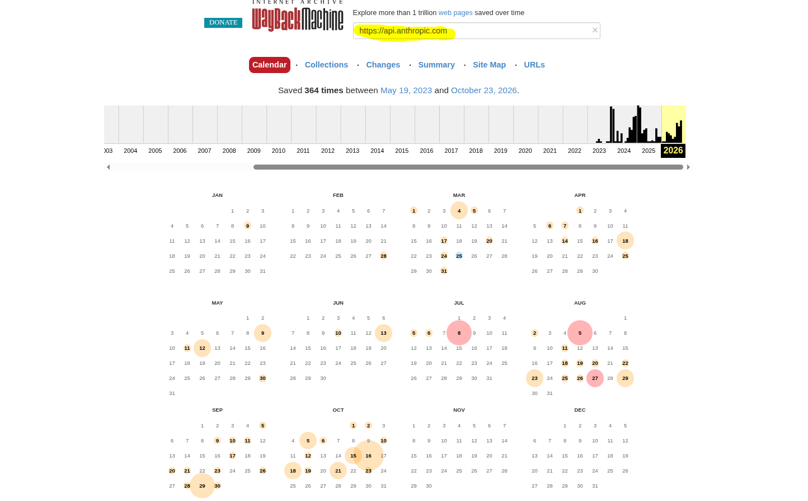
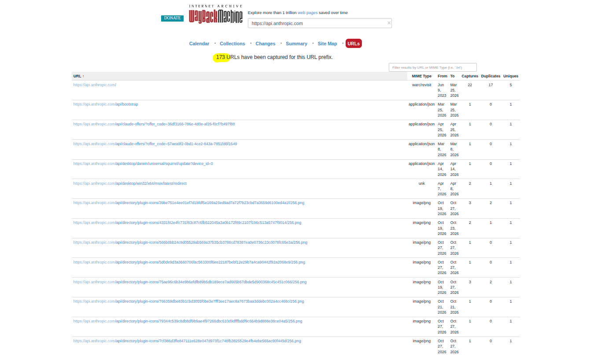
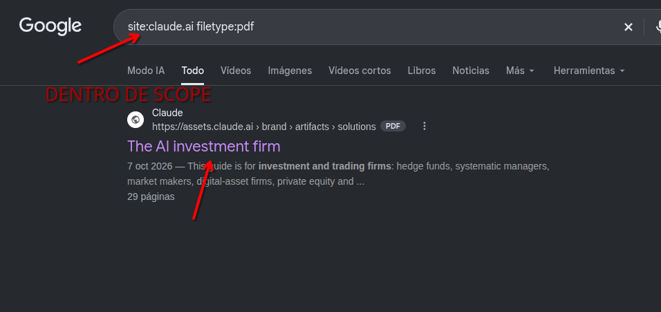
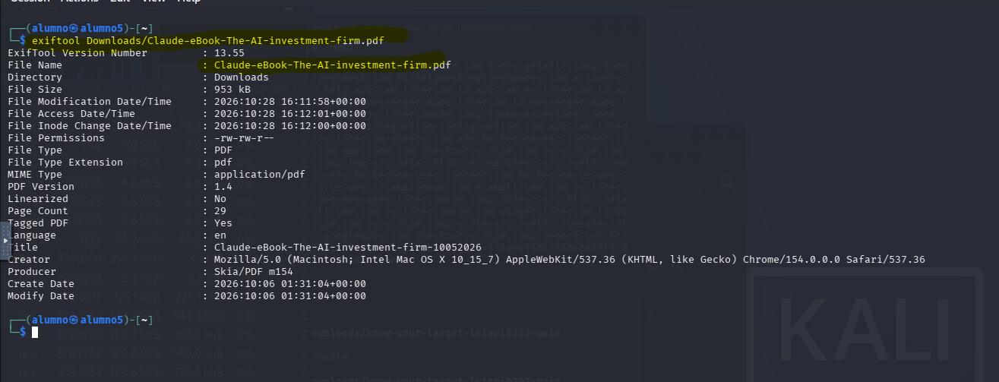
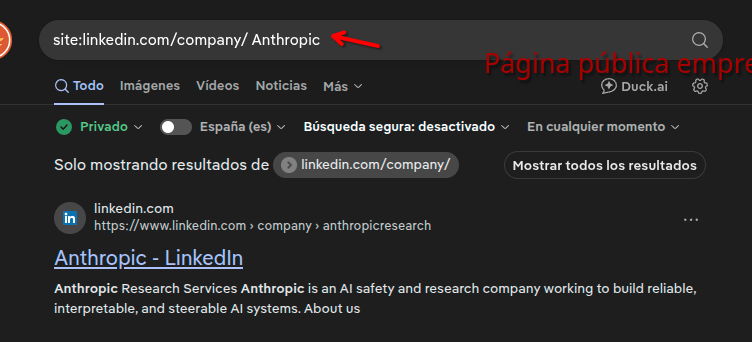
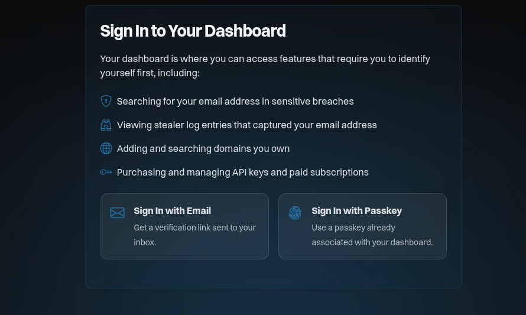
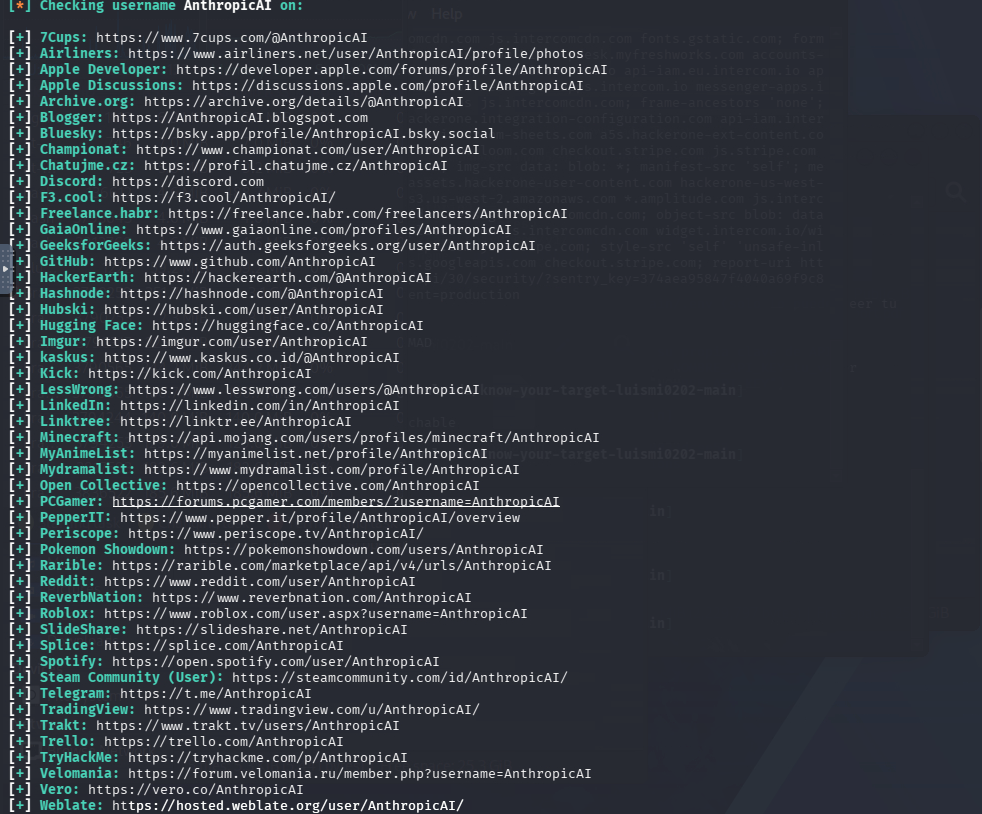

# Cuaderno de reconocimiento pasivo

En este cuaderno anoto qué consulté, qué devolvió cada fuente y qué utilidad tiene el dato. "Pasivo" describe aquí el tipo de reconocimiento: no hice escaneos de puertos ni pruebas contra servicios, aunque algunas consultas (por ejemplo, DNS o descargar un archivo público con `curl`) sí generan peticiones a una fuente. La lista de `scope.txt` es una allowlist estricta. Los nombres descubiertos que no aparecen allí no se consideran autorizados para probar.

## Registro 1 — Preparación del alcance

- **Fecha:** 28/10/2026
- **Objetivo:** Inventario inicial de activos de Anthropic.
- **Técnica:** Revisión de la política y del CSV público de HackerOne.
- **Fuente:** https://hackerone.com/anthropic
- **Acción:** Revisé las directrices del programa y seleccioné hosts para el reconocimiento pasivo.
- **Resultado:** Se creó `scope.txt` con siete hosts para la revisión inicial.
- **Interpretación:** Revisé qué sistemas incluye el programa y apunté los nombres que aparecen expresamente en la información de alcance. Esto evita confundir un dominio que aparece en internet con uno que está autorizado para analizar. La lista contiene siete hosts concretos y no usa comodines, así que un subdominio nuevo no entra automáticamente.
- **Limitaciones:** La inclusión en este listado no autoriza pruebas activas. Se respetarán las instrucciones específicas de cada activo.
- **Siguiente paso:** Consultar información WHOIS pública y registrar los resultados.

## Registro 2 — WHOIS de claude.ai

- **Fecha:** 28/10/2026
- **Objetivo:** claude.ai
- **Estado de alcance:** incluido en `scope.txt`.
- **Técnica:** Consulta registral pasiva mediante ICANN Lookup.
- **Fuente:** https://lookup.icann.org/
- **Acción:** Consulté los datos públicos del registro del dominio.
- **Resultado observado:**
  - Registrador: Markmonitor Inc.
  - Creación: 2018-08-04.
  - Expiración: 2029-08-04.
  - Última actualización indicada: 2026-08-12.
  - Nameservers: isla.ns.cloudflare.com y randy.ns.cloudflare.com.
  - Estados: clientDeleteProhibited, clientTransferProhibited y clientUpdateProhibited.
  - DNSSEC: la delegación aparece como Unsigned.
  - Los datos de contacto del titular aparecen redactados por privacidad.
- **Interpretación:** WHOIS ofrece la ficha pública del dominio: registrador, fechas y servidores de nombres. En este caso, la consulta desde la terminal no funcionó y usé ICANN Lookup. El resultado identifica a Markmonitor, muestra los nameservers de Cloudflare y protege los datos del titular. Esto ayuda a entender quién gestiona el registro y a dónde se delega el DNS, pero no demuestra que haya un problema de seguridad.
- **Limitación:** El comando `whois` desde Kali devolvió `Network is unreachable`. Se utilizó ICANN Lookup como alternativa web.
- **Siguiente paso:** Consultar los registros DNS públicos.


## Registro 3 — DNS A de claude.ai

- **Fecha:** 28/10/2026
- **Objetivo:** claude.ai
- **Estado de alcance:** incluido en `scope.txt`.
- **Técnica:** Consulta DNS pasiva mediante dig.
- **Comando:** dig claude.ai A
- **Servidor DNS consultado:** 8.8.8.8.
- **Resultado observado:** NOERROR. Se obtuvo un registro A con la dirección IPv4 `160.79.104.10` y TTL de 300 segundos.
- **Interpretación:** El tipo A del DNS relaciona un nombre con una dirección IPv4. `claude.ai` apuntaba a `160.79.104.10` en el momento de la consulta. Es una instantánea que puede cambiar y, por sí sola, no indica qué servicio hay detrás. La IP se consultó después en Shodan InternetDB.
- **Limitación:** Una única consulta no permite afirmar que sea la única dirección IP asociada al dominio.
- **Siguiente paso:** Consultar el registro MX para comprobar si el dominio publica información de servidores de correo.


## Registro 4 — DNS MX de claude.ai

- **Fecha:** 28/10/2026
- **Objetivo:** claude.ai
- **Estado de alcance:** incluido en `scope.txt`.
- **Técnica:** Consulta DNS pasiva mediante dig.
- **Comando:** dig claude.ai MX
- **Resultado observado:** Estado NOERROR, ANSWER: 0. No se devolvieron registros MX. La sección AUTHORITY contiene un registro SOA que identifica isla.ns.cloudflare.com como servidor primario indicado.
- **Servidor DNS consultado:** 8.8.8.8.
- **Interpretación:** El registro MX indica qué servidores reciben el correo de un dominio. La consulta de `claude.ai` no devolvió ninguno. Esto describe solo lo que publica ese dominio, no permite concluir que la organización carezca de correo, ya que podría gestionarlo desde otro dominio.
- **Limitación:** Este resultado no permite concluir que Anthropic carezca de servicios de correo.
- **Siguiente paso:** Consultar el registro TXT público del dominio.


## Registro 5 — DNS TXT de claude.ai

- **Fecha:** 28/10/2026
- **Objetivo:** claude.ai
- **Estado de alcance:** incluido en `scope.txt`.
- **Técnica:** Consulta DNS pasiva mediante dig.
- **Comando:** dig claude.ai TXT
- **Contenido observado:** Cuatro registros google-site-verification, un registro SPF con valor "v=spf1 -all" y una cadena TXT adicional cuyo propósito no se ha determinado.
- **Servidor DNS consultado:** 8.8.8.8.
- **Interpretación:** Los registros TXT permiten publicar texto asociado al dominio, como verificaciones de servicios o políticas de correo. La consulta devolvió seis registros: cuatro de verificación de Google, uno con `v=spf1 -all` y otro cuyo propósito no identifiqué. Son pistas de servicios vinculados y de la política SPF publicada, sin que se hayan validado las verificaciones ni se pueda afirmar para qué sirve el texto desconocido.
- **Limitación:** No se ha verificado el propósito de la cadena adicional ni se han probado los mecanismos de verificación.
- **Siguiente paso:** Consultar los registros CAA públicos del dominio.


## Registro 6 — DNS CAA de claude.ai

- **Fecha:** 28/10/2026
- **Objetivo:** claude.ai
- **Estado de alcance:** incluido en `scope.txt`.
- **Técnica:** Consulta DNS pasiva mediante dig.
- **Comando:** dig claude.ai CAA
- **Resultado observado:** NOERROR. Se devolvieron 18 registros CAA, con TTL de 300 segundos.
- **Contenido observado:** Registros issue e issuewild que mencionan distintas autoridades certificadoras, entre ellas Let's Encrypt, DigiCert, Amazon, SSL.com, Google PKI y otras.
- **Servidor DNS consultado:** 8.8.8.8.
- **Interpretación:** CAA publica qué autoridades certificadoras pueden emitir certificados para el dominio. La respuesta mostró 18 registros. Los anoto como referencia de la política publicada, pero no comprobé certificados ni intenté emitir uno. La presencia de estos registros no significa que se haya encontrado una vulnerabilidad.
- **Limitación:** La consulta no verifica certificados emitidos ni demuestra vulnerabilidades.
- **Siguiente paso:** Consultar los registros AAAA públicos del dominio.


## Registro 7 — DNS AAAA de claude.ai

- **Fecha:** 28/10/2026
- **Objetivo:** claude.ai
- **Estado de alcance:** incluido en `scope.txt`.
- **Técnica:** Consulta DNS pasiva mediante dig.
- **Comando:** dig claude.ai AAAA
- **Servidor DNS consultado:** 8.8.8.8.
- **Interpretación:** El tipo AAAA cumple una función parecida al A, pero devuelve una dirección IPv6. Para `claude.ai` apareció `2607:6bc0::10`, junto a la IPv4 anotada antes. Es un dato puntual que puede cambiar y evita que el inventario se limite a IPv4.
- **Limitación:** Los resultados corresponden a una observación puntual y pueden cambiar.
- **Siguiente paso:** Revisar los registros NS del dominio.


## Registro 8 — DNS NS de claude.ai

- **Fecha:** 28/10/2026
- **Objetivo:** claude.ai
- **Estado de alcance:** incluido en `scope.txt`.
- **Técnica:** Consulta DNS pasiva mediante dig.
- **Comando:** dig claude.ai NS
- **TTL:** 21600 segundos para ambos registros.
- **Servidor DNS consultado:** 8.8.8.8.
- **Interpretación:** Los registros NS indican qué servidores responden por el DNS del dominio. La consulta devolvió `isla.ns.cloudflare.com` y `randy.ns.cloudflare.com`, los mismos que vi en ICANN Lookup. Ambas fuentes coinciden, lo que apunta a que Cloudflare gestiona el DNS, pero no informa sobre la seguridad de esos servidores.
- **Limitación:** La consulta identifica servidores DNS, pero no demuestra la existencia ni ausencia de vulnerabilidades.
- **Siguiente paso:** Continuar con el descubrimiento pasivo de subdominios en el registro 9. El registro SOA no se consultó.


## Registro 9 — Descubrimiento pasivo de subdominios

- **Fecha:** 28/10/2026
- **Objetivo:** anthropic.com
- **Estado de alcance:** `anthropic.com` no está en la allowlist de `scope.txt`. Se consultó crt.sh como fuente pública de certificados, no como autorización para probar el dominio ni sus subdominios.
- **Técnica:** Consulta de certificados TLS públicos mediante crt.sh.
- **Fuente:** https://crt.sh/?q=%25.anthropic.com
- **Comando utilizado:** curl -s 'https://crt.sh/?q=%25.anthropic.com&output=json' | python3 -c 'import sys,json, d=json.load(sys.stdin), print("\n".join(sorted({x["name_value"] for x in d if x.get("name_value")})))'
- **Comando utilizado:**
  ```sh
  curl -s 'https://crt.sh/?q=%25.anthropic.com&output=json' | python3 -c '
  import sys, json
  data = json.load(sys.stdin)
  print("\n".join(sorted({entry["name_value"] for entry in data if entry.get("name_value")})))
  '
  ```
- **Resultado observado:** Se obtuvieron numerosos nombres de dominio y subdominio, con duplicados eliminados por el comando y algunos nombres wildcard.
- **Ejemplos encontrados:** api.anthropic.com, api-staging.anthropic.com, console.anthropic.com, docs.anthropic.com, support.anthropic.com, status.anthropic.com y www.anthropic.com.
- **Interpretación:** Los certificados TLS públicos pueden incluir los nombres de los sitios para los que se emitieron. Consulté crt.sh para identificar nombres relacionados con Anthropic y compararlos con `scope.txt`. Encontrar un nombre no confirma que siga activo ni que esté autorizado, por eso los nombres fuera de la allowlist no se añaden automáticamente.
- **Limitación:** Los resultados no confirman que todos los nombres estén activos ni que pertenezcan al alcance autorizado. Se contrastarán con scope.txt y la política del programa.
- **Siguiente paso:** Revisar la huella tecnológica con Netcraft.


## Registro 10 — Huella tecnológica con Netcraft

- **Fecha:** 28/10/2026
- **Objetivo consultado:** anthropic.com
- **Estado de alcance:** `anthropic.com` no está en `scope.txt`, se consultó el informe público de Netcraft como fuente de información y no se considera un objetivo autorizado para pruebas.
- **Técnica:** Fingerprinting pasivo mediante Netcraft Site Report.
- **Fuente:** https://sitereport.netcraft.com/
- **Resultado observado:** Netcraft identifica Anthropic, PBC como propietario del bloque de red. Indica SignalPoint Communications como empresa de hosting, Cloudflare como CDN/DNS y Google HTTPS Load Balancer como tecnología de aceleración HTTP.
- **Direcciones observadas:** IPv4 160.79.104.10 e IPv6 2607:6bc0::10.
- **DNS:** isla.ns.cloudflare.com. El informe indica DNSSEC habilitado para el dominio consultado.
- **Correo:** el informe muestra SPF con include de _spf.google.com y softfail, además de DMARC con políticas p=reject y sp=reject.
- **Otras tecnologías detectadas:** JavaScript, React Server Components, gzip y varias cabeceras de seguridad del navegador.
- **Interpretación:** Netcraft reúne información pública sobre proveedores de alojamiento, CDN y tecnologías web. Consulté su informe para obtener una primera idea de la infraestructura sin probar el sitio. Los datos sobre Cloudflare, Google HTTPS Load Balancer y otras tecnologías son indicios de un tercero, pueden ser incompletos o inexactos, y corresponden a `anthropic.com`, que no está en mi allowlist.
- **Limitación:** Son detecciones de terceros y pueden ser incompletas o variar con el tiempo. El informe consultado corresponde a una URL HTTP. No se comprobó aquí el informe HTTPS ni se realizaron pruebas activas.
- **Siguiente paso:** Revisar robots.txt y security.txt de forma pasiva.


## Registro 11 — Consulta de robots.txt

- **Fecha:** 28/10/2026
- **Objetivo:** anthropic.com
- **Estado de alcance:** `anthropic.com` no está en `scope.txt`. La petición GET consultó un archivo público, pero no amplía el alcance autorizado.
- **Técnica:** Revisión pasiva de robots.txt.
- **Comando:** curl -sS -L --max-time 15 https://anthropic.com/robots.txt
- **Resultado observado:** User-Agent: *, Allow: / y Sitemap: https://www.anthropic.com/sitemap.xml.
- **Interpretación:** `robots.txt` indica a los rastreadores qué rutas deberían visitar o evitar. La consulta mostró `Allow: /` y un enlace al sitemap. No es una lista de permisos ni una barrera de seguridad, y que una ruta aparezca allí no significa que se deba entrar o probar.
- **Limitación:** robots.txt no es un mecanismo de control de acceso ni confirma que no existan otras rutas.
- **Siguiente paso:** Consultar security.txt en la ubicación estándar.


## Registro 12 — Consulta de security.txt

- **Fecha:** 28/10/2026
- **Objetivo:** anthropic.com
- **Estado de alcance:** `anthropic.com` no está en `scope.txt`, la petición GET consultó un archivo público de contacto y no autoriza pruebas sobre el dominio.
- **Técnica:** Revisión pasiva del archivo security.txt.
- **Comando:** curl -sS -L --max-time 15 https://anthropic.com/.well-known/security.txt
- **Resultado observado:** El archivo declara un contacto de HackerOne, fecha de expiración 2026-12-31, idioma preferido inglés, URL canónica, política de divulgación responsable y página de empleo.
- **Interpretación:** `security.txt` permite a una organización publicar cómo quiere recibir avisos de seguridad. La consulta identificó el canal de reporte, la política de divulgación, el idioma y la fecha de expiración declarada. No envié informes ni hice pruebas. El archivo se consultó en `anthropic.com`, fuera de la allowlist de este ejercicio.
- **Limitación:** La presencia de estos enlaces no implica que se haya enviado un informe ni que se haya validado ninguna vulnerabilidad.
- **Siguiente paso:** Consultar información pública de servicios mediante Shodan InternetDB, sin escanear el objetivo.


## Registro 13 — Shodan InternetDB

- **Fecha:** 28/10/2026
- **Objetivo:** IP 160.79.104.10, obtenida previamente mediante DNS.
- **Estado de alcance:** la IP se obtuvo al consultar `claude.ai`, que sí figura en `scope.txt`. Aquí solo se consultó la base pública de Shodan, sin contactar con los puertos listados.
- **Técnica:** Consulta pasiva de información pública con Shodan InternetDB.
- **Fuente:** https://internetdb.shodan.io/160.79.104.10
- **Comando:** curl -sS --max-time 15 https://internetdb.shodan.io/160.79.104.10
- **Resultado observado:** La respuesta JSON enumera los nombres claude.anthropic.com y a.anthropic.com, el CPE cpe:/a:cloudflare:cloudflare, los puertos 80, 443, 2052, 2082, 2083, 2086, 2087, 2096, 8080, 8443 y 8880, la etiqueta pqc y una lista vacía de vulnerabilidades.
- **Interpretación:** InternetDB es una base pública de Shodan que muestra datos ya recopilados sobre una dirección IP. Consulté la IP encontrada en DNS, sin escanearla. La respuesta incluía nombres relacionados, una etiqueta de Cloudflare y puertos registrados por la fuente. No comprobé si esos puertos responden ahora ni intenté conectarme a ellos, por lo que la información puede estar desactualizada.
- **Limitación:** Los datos de InternetDB pueden estar incompletos o desactualizados. No se realizaron conexiones a los puertos ni pruebas de vulnerabilidad.
- **Siguiente paso:** Realizar búsquedas públicas mediante Google dorks.


## Registro 14 — Google dorks: documentos PDF

- **Fecha:** 28/10/2026
- **Objetivo:** anthropic.com
- **Estado de alcance:** la búsqueda usa `anthropic.com` como filtro del buscador. Esto no convierte los resultados ni los hosts enlazados en activos autorizados por `scope.txt`.
- **Técnica:** Búsqueda pasiva mediante Google dorks.
- **Consulta:** site:anthropic.com filetype:pdf
- **Resultado observado:** Se encontraron varios PDF indexados, incluidos informes corporativos, documentos de investigación y publicaciones sobre seguridad de IA. Algunos resultados utilizan el dominio www-cdn.anthropic.com.
- **Interpretación:** Un dork es una búsqueda normal en Google con filtros para acotar resultados. Usé `site:anthropic.com filetype:pdf` para localizar PDF ya indexados. Los resultados incluyen documentos y nombres de dominio asociados, pero no demuestran una exposición indebida ni que los dominios estén dentro del alcance.
- **Limitación:** La indexación pública no demuestra una exposición indebida. La búsqueda se limitó a los resultados indexados y no se descargaron documentos para buscar información sensible.
- **Siguiente paso:** Buscar información de contacto corporativa mediante fuentes públicas.


## Registro 15 — Búsqueda pasiva de correos con theHarvester

- **Fecha:** 28/10/2026
- **Objetivo:** anthropic.com
- **Estado de alcance:** `anthropic.com` no está en `scope.txt`. theHarvester consultó la fuente pública crt.sh, sin buscar directamente en los buzones de empleados.
- **Técnica:** Recopilación pasiva de información pública.
- **Herramienta:** theHarvester 4.11.1.
- **Comando:** theHarvester -d anthropic.com -b crtsh
- **Fuente consultada:** CRTsh.
- **Resultado observado:** No se encontraron direcciones IP, correos electrónicos, personas ni hosts en esta consulta.
- **Interpretación:** theHarvester reúne datos públicos desde distintas fuentes. En esta ejecución usé crt.sh, una fuente basada en certificados que no está especializada en correos. No devolvió emails ni personas. Esto solo indica que esa combinación de herramienta y fuente no encontró resultados, no demuestra que no existan correos públicos ni permite deducir un patrón corporativo.
- **Limitación:** La ausencia de resultados no demuestra que no existan correos o hosts públicos.
- **Siguiente paso:** Revisar que los resultados estén reflejados en el mapa de reconocimiento.


## Contraste entre fuentes

- En `claude.ai`, ICANN Lookup y `dig` coinciden en los nameservers `isla.ns.cloudflare.com` y `randy.ns.cloudflare.com` (registros 2 y 8).
- La dirección IPv4 `160.79.104.10` obtenida con `dig claude.ai A` es la misma que Shodan InternetDB consultó después (registros 3 y 13). Esto enlaza la consulta con la fuente pública, pero no verifica los puertos ni el estado actual del servicio.
- Netcraft también reportó `160.79.104.10` y `2607:6bc0::10`, pero su informe era de `anthropic.com`, mientras que las consultas DNS se hicieron para `claude.ai` (registros 3, 7 y 10). La coincidencia de direcciones es una pista para el inventario, no prueba por sí sola que ambos nombres tengan la misma configuración o autorización.
- El resultado de crt.sh se contrastó con `scope.txt` para separar nombres expresamente enumerados de nombres descubiertos. La captura conserva más entradas que las transcritas como ejemplos, así que no se considera un inventario completo de subdominios.

## Registro 16 — Resolución DNS de api.anthropic.com

- **Fecha:** 28/10/2026
- **Objetivo:** api.anthropic.com
- **Estado de alcance:** hostname incluido en `scope.txt`.
- **Técnica:** Resolución DNS de las direcciones IPv4 e IPv6, como primer paso de la técnica opcional de identificación de las IPs.
- **Comandos:** `dig api.anthropic.com A +short` y `dig api.anthropic.com AAAA +short`.
- **Resultado observado:** A devolvió `160.79.104.10` y AAAA devolvió `2607:6bc0::10`.
- **Interpretación:** Consulté las direcciones que publica el DNS para `api.anthropic.com`. Aparecieron una IPv4 y una IPv6, iguales a las anotadas para `claude.ai`. ARIN indica que ambos bloques están registrados a nombre de Anthropic, PBC. Estos datos no permiten asegurar si hay un CDN o WAF delante ni qué servicio atiende cada hostname.
- **Limitación:** La respuesta DNS es puntual y no identifica por sí sola al titular de las direcciones ni confirma si el tráfico pasa por un WAF o CDN.
- **Consulta RDAP:** ARIN, https://rdap.arin.net/registry/ip/160.79.104.10
- **Resultado RDAP observado:** ARIN devuelve el bloque `160.79.104.0/21` (desde `160.79.104.0` hasta `160.79.111.255`), con estado `active`, registrado a nombre de Anthropic, PBC. El objeto de red figura como `AP-2440`.
- **Interpretación:** La respuesta registral atribuye ese bloque IPv4 a Anthropic, PBC. Esto identifica la organización que registra el bloque, pero no permite determinar por sí solo si el tráfico hacia el hostname pasa por un CDN o WAF.
- **Consulta RDAP IPv6:** ARIN, https://rdap.arin.net/registry/ip/2607:6bc0::10
- **Resultado RDAP IPv6:** ARIN devuelve el bloque `2607:6bc0::/32`, desde `2607:6bc0::` hasta `2607:6bc0:ffff:ffff:ffff:ffff:ffff:ffff`, con estado `active`, registrado a nombre de Anthropic, PBC. El objeto de red figura como `ANTHROPIC-V6`, handle `NET6-2607-6BC0-1`.
- **Interpretación:** Tanto el bloque IPv4 como el IPv6 consultados figuran registrados a nombre de Anthropic, PBC. La titularidad registral no permite determinar por sí sola si el tráfico pasa por un CDN o WAF.
- **Limitaciones:** Las respuestas DNS son puntuales. Los datos RDAP identifican la organización registrada para los bloques, pero no necesariamente la ruta o arquitectura actual del servicio.
- **Siguiente paso:** Revisar el listado de URLs de Wayback Machine, documentado en el registro 17.





## Registro 17 — Wayback Machine para api.anthropic.com

- **Fecha:** 28/10/2026
- **Objetivo:** `https://api.anthropic.com`
- **Estado de alcance:** hostname incluido en `scope.txt`.
- **Técnica:** Consulta pasiva del calendario de Wayback Machine.
- **Fuente:** https://web.archive.org/
- **Acción:** Busqué la URL del hostname y revisé el calendario de capturas.
- **Resultado observado:** El calendario indica 364 capturas entre el 19/05/2023 y el 23/10/2026. La pestaña “URLs” lista 173 URLs, entre ellas `/api/bootstrap`, `/api/claude-offers/`, rutas de actualización de escritorio (`/api/desktop/...`) y recursos del directorio de plugins (`/api/directory/plugins` y `/api/directory/plugin-icons/...`).
- **Interpretación:** Wayback Machine conserva un índice histórico de páginas y URLs. Para `api.anthropic.com` muestra 364 capturas y lista 173 URLs con rutas de API, actualización de aplicaciones y recursos de plugins. Es un inventario histórico, no una confirmación de que esas rutas sigan activas.
- **Limitación:** Son datos del índice de Wayback Machine y pueden incluir parámetros, duplicados o capturas que ya no estén disponibles. No se abrieron las páginas archivadas ni se probaron las rutas.
- **Siguiente paso:** Revisar el requisito de titularidad de HIBP, documentado en el registro 20.



## Registro 18 — Prueba de ExifTool fuera del alcance

- **Fecha:** 28/10/2026
- **Objetivo consultado:** `https://assets.claude.ai/brand/artifacts/solutions/financial%20advisors/Claude-eBook-The-AI-investment-firm.pdf`
- **Técnica:** Lectura local de metadatos de un PDF con ExifTool, únicamente como prueba.
- **Comando:** `exiftool Downloads/Claude-eBook-The-AI-investment-firm.pdf`.
- **Resultado observado:** PDF 1.4, 29 páginas, idioma `en`, título `Claude-eBook-The-AI-investment-firm-10052026`, creador indicado como Chrome 154 en macOS 10.15.7 y productor `Skia/PDF m154`. Las fechas internas de creación y modificación son 06/10/2026.
- **Estado de alcance:** fuera de alcance. `assets.claude.ai` no figura como hostname exacto en `scope.txt`.
- **Interpretación:** ExifTool mostró datos técnicos del único PDF localizado, como el formato, el número de páginas, el programa con que se generó y sus fechas. No apareció un campo de autor. El archivo está alojado en `assets.claude.ai`, fuera de la lista permitida, así que esta prueba no cuenta como trabajo dentro del alcance.
- **Limitación:** Este fue el único resultado localizado. No apareció ningún PDF servido desde los hostnames exactos de `scope.txt`. El archivo encontrado está en un hostname fuera de alcance, por lo que esta prueba no se presenta como reconocimiento autorizado ni como técnica opcional completada.
- **Siguiente paso:** ExifTool queda pendiente dentro del alcance. Este resultado no amplía `scope.txt` ni justifica nuevas consultas a `assets.claude.ai`.



## Registro 19 — Información corporativa pública en LinkedIn

- **Fecha:** 28/10/2026
- **Objetivo:** Anthropic, como organización.
- **Técnica:** Consulta pasiva de la página pública de empresa y de vacantes visibles en LinkedIn.
- **Fuente:** LinkedIn, página pública de Anthropic y listado público de empleos.
- **Acción:** Revisé el resumen de empresa y los anuncios de empleo accesibles sin iniciar sesión.
- **Resultado observado:** La descripción presenta Anthropic como empresa de investigación en IA centrada en sistemas fiables, interpretables y dirigibles. LinkedIn muestra el sector “Servicios de investigación”, tamaño de empresa de 501–1.000 empleados y financiación privada. La página anuncia 6.224 empleados asociados, pero exige iniciar sesión para ver la lista completa. Entre las vacantes públicas observadas había puestos de ciencia de datos, seguridad de sistemas autónomos, aplicaciones principales, asesoría de patentes y ventas para el sector farmacéutico, con ubicaciones como Nueva York, San Francisco, Seattle y Boston.
- **Interpretación:** Sin iniciar sesión, pude leer el resumen público de Anthropic y algunos anuncios de empleo. Esto da pistas generales sobre sus áreas de trabajo, pero no permite revisar a todos los empleados. La cifra de empleados asociados y el rango de tamaño son métricas distintas de LinkedIn y no se verificaron de forma independiente.
- **Limitación:** La información procede de un tercero, puede cambiar y parte de la página requiere iniciar sesión. No se recopilaron nombres, perfiles, fotografías ni datos de contacto de empleados, y tampoco se contactó a nadie.
- **Siguiente paso:** Revisar HIBP y el alias corporativo en los registros 20-22.


## Registro 20 — Requisito de dominio en Have I Been Pwned

- **Fecha:** 28/10/2026
- **Objetivo:** Comprobar si Have I Been Pwned permite consultar dominios sin verificar su titularidad.
- **Técnica:** Revisión de la página de acceso y de las funciones del panel.
- **Fuente:** https://haveibeenpwned.com/DomainSearch
- **Acción:** Abrí la página del panel sin iniciar sesión y revisé las funciones que requieren identificación.
- **Resultado observado:** La página indica que se necesita iniciar sesión para buscar dominios propios. También presenta otras funciones autenticadas, como búsquedas de direcciones de correo.
- **Interpretación:** HIBP permite buscar filtraciones asociadas a dominios que el usuario puede demostrar que controla. Como no controlamos el dominio de Anthropic, no hicimos la búsqueda ni intentamos saltarnos ese requisito. La captura documenta por qué esta opción queda pendiente.
- **Limitación:** No controlamos el dominio de Anthropic, así que esta búsqueda no puede completarse de forma autorizada desde este ejercicio. No se intentó iniciar sesión, verificar el dominio ni consultar direcciones personales.
- **Siguiente paso:** HIBP queda sin realizar por el requisito de titularidad. Sherlock se documenta en el registro 22 y sus coincidencias se tratan como candidatas no verificadas.


## Registro 21 — Alias corporativo enlazado desde la web oficial

- **Fecha:** 28/10/2026
- **Objetivo:** Comprobar la procedencia pública del alias `@AnthropicAI`.
- **Estado de alcance:** `anthropic.com` no está en `scope.txt`. Se consultó únicamente como fuente pública de atribución, sin probar el sitio.
- **Técnica:** Revisión de enlaces sociales publicados en la web corporativa.
- **Fuente:** https://www.anthropic.com/
- **Acción:** Revisé los enlaces sociales del pie de página.
- **Resultado observado:** La web enlaza a `https://x.com/AnthropicAI` y lo identifica como la cuenta de X de Anthropic. También enlaza a cuentas corporativas de YouTube y LinkedIn.
- **Interpretación:** La web oficial enlaza directamente la cuenta `@AnthropicAI` en X, por lo que ese alias corporativo queda confirmado. La búsqueda de Sherlock se describe en el registro siguiente, sus coincidencias en otras plataformas no se consideran oficiales sin una fuente que las confirme.
- **Limitación:** `anthropic.com` y X no están en la allowlist de `scope.txt`. La comprobación se limitó a leer el enlace publicado por la empresa. No se inició sesión, interactuó con cuentas ni se buscaron perfiles de empleados.
- **Siguiente paso:** El registro 22 documenta Sherlock: las coincidencias son candidatas y solo X queda confirmado por el enlace oficial.

## Registro 22 — Búsqueda del alias AnthropicAI con Sherlock

- **Fecha:** 28/10/2026
- **Objetivo:** Comprobar la presencia pública del alias corporativo `AnthropicAI`.
- **Técnica:** Búsqueda automatizada de un mismo nombre de usuario en plataformas públicas mediante Sherlock.
- **Fuente:** Salida de Sherlock compartida en esta sesión. El alias se corroboró en https://www.anthropic.com/.
- **Acción:** Ejecuté Sherlock sobre `AnthropicAI`. La salida enumeró coincidencias candidatas en distintas plataformas. No se abrieron los perfiles ni se contactó con sus titulares.
- **Resultado observado:** Sherlock mostró numerosas URLs candidatas, entre ellas páginas de GitHub, Hugging Face, Reddit, Bluesky, LinkedIn y YouTube. La web oficial enlaza `https://x.com/AnthropicAI`, por lo que esa cuenta sí queda confirmada. La web oficial también enlaza una cuenta corporativa de YouTube con otro alias (`anthropic-ai`) y una página de empresa de LinkedIn distinta del perfil personal que Sherlock listó.
- **Interpretación:** Sherlock permite revisar de forma rápida dónde aparece el mismo alias. La herramienta busca el nombre indicado, no descubre automáticamente alias diferentes. Sus resultados `+` son coincidencias candidatas y no prueban que cada cuenta pertenezca a Anthropic. Solo se atribuye la cuenta de X porque la web oficial enlaza directamente ese perfil.
- **Limitación:** No se verificaron las demás URLs. Algunas pueden ser falsos positivos, páginas genéricas o cuentas de terceros que usan el mismo nombre. No se recopilaron datos personales ni se investigaron empleados.
- **Siguiente paso:** No ampliar la búsqueda a perfiles personales. Si se usa el resultado, conservar solo el enlace corporativo confirmado por la fuente oficial y tratar el resto como no verificado.


## Resumen de técnicas opcionales

- **DNS y RDAP:** completados para `api.anthropic.com` (registro 16). Las direcciones coinciden con las observadas para `claude.ai`, y ARIN registra los bloques consultados a nombre de Anthropic, PBC.
- **Wayback Machine:** consultada para `api.anthropic.com` (registro 17). Sus rutas son históricas, no se probaron.
- **ExifTool:** solo se hizo una prueba con un PDF de `assets.claude.ai`, fuera de alcance (registro 18). No cuenta como técnica completada dentro del alcance.
- **LinkedIn:** se revisó información pública de la empresa y vacantes (registro 19). No se recopilaron datos personales de empleados.
- **Have I Been Pwned:** no se realizó la búsqueda porque exige acreditar el control del dominio (registro 20).
- **Sherlock:** se buscó el alias corporativo `AnthropicAI` (registro 22). Solo se confirma la cuenta de X enlazada desde la web oficial, las demás coincidencias quedan sin verificar.
